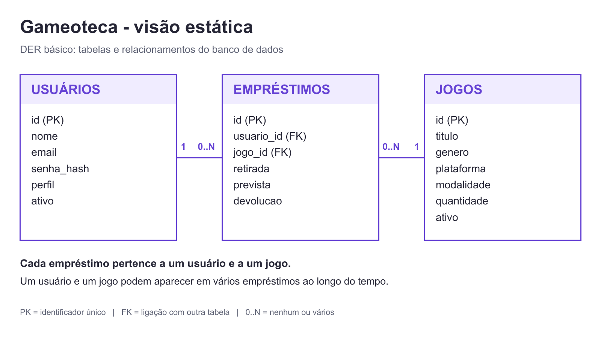

# Gameoteca

Sistema desktop em Java 21 e Swing para cadastrar usuários e jogos e controlar empréstimos em uma ludoteca de videogames e PC. O SGBD utilizado é SQLite, acessado por JDBC.

Repositório: https://github.com/mariogabriel123/Sistema-Gameoteca

## Executar

Abra a pasta que contém `pom.xml` no VS Code ou no NetBeans. Aguarde o carregamento das bibliotecas e execute `src/main/java/br/com/gameoteca/App.java`. No VS Code, se houver aviso sobre o `pom.xml`, use **Java: Reload Projects**. No NetBeans, configure o JDK 21 e a classe principal `br.com.gameoteca.App`.

No primeiro acesso, crie seu administrador. Depois cadastre os usuários e jogos pelas abas. Não existe senha padrão nem carga automática de exemplos.

Quando já existe um administrador, a tela de login oferece **Entrar** e **Criar uma nova conta**. O cadastro pede nome, e-mail, senha e confirmação. As novas contas criadas nessa tela são sempre de membro; depois do cadastro, o usuário entra automaticamente. A promoção para administrador continua exclusiva do administrador, pela aba Usuários.

O Maven baixa as bibliotecas declaradas em `pom.xml`. A primeira importação precisa de internet. Ele é uma ferramenta de compilação, não um framework do sistema. A pasta `.mvn` e os arquivos de wrapper não são necessários nesta versão.

## Organização

Os arquivos Java ficam no pacote `br.com.gameoteca`, dentro de `src/main/java/br/com/gameoteca`. `src/main/java` é a estrutura padrão do Maven; o nome do pacote foi escolhido para este projeto.

| Pasta | Função | Nome citado no enunciado |
|---|---|---|
| `controle` | Recebe as ações das telas e encaminha ao serviço. | controller |
| `regras` | Valida cadastros, permissões e regras de empréstimo. | service |
| `banco` | Salva, consulta, atualiza e exclui os registros com SQL. | repository / dao |
| `modelo` | Representa usuários, jogos e empréstimos como objetos. | model |
| `telas` | Contém as janelas e os formulários da interface Swing. | view |
| `apoio` | Abre conexões com o banco e protege as senhas. | util |
| `erros` | Define a exceção usada para avisar sobre regras não atendidas. | exception |

`App.java` inicia o programa. O arquivo `src/main/resources/db/schema.sql` cria as três tabelas e seus relacionamentos.

Fluxo: **Tela > Controle > Regras > Banco**.

## Visão estática

Cada empréstimo liga um usuário a um jogo e guarda as datas de retirada, previsão de devolução e devolução. Um usuário e um jogo podem aparecer em vários empréstimos ao longo do tempo.

## Regras

O administrador gerencia usuários, jogos e devoluções. Membros consultam jogos ativos, solicitam para si e acompanham seus empréstimos. Mídias físicas têm prazo de sete dias. Acesso local registra o uso nas estações da ludoteca e deve ser encerrado no mesmo dia; o programa não instala nem transfere jogos.

Cada usuário pode ter até três jogos em andamento, sem repetir um cadastro já emprestado. Atrasos impedem novas retiradas. A devolução confirmada libera a unidade. Cadastros com histórico devem ser desativados em vez de excluídos. Um administrador não pode excluir ou desativar a própria conta.

Na aba Empréstimos, o administrador pode usar **Excluir registro** para remover um empréstimo devolvido selecionado ou **Limpar histórico** para remover todos os devolvidos. As ações pedem confirmação. Registros em andamento são preservados. A exclusão é permanente e não muda a disponibilidade dos jogos, pois as unidades já foram liberadas na devolução.

## Orientação a objetos

`Jogo` é uma classe abstrata. `JogoFisico` e `JogoLocal` herdam seus dados e sobrescrevem `getPrazoDias()`. O cálculo da devolução chama esse método de forma polimórfica. Os campos são privados, e as listas reúnem os objetos consultados. `CrudRepository<T>` define uma interface comum para persistência, seguindo o padrão Repository/DAO. `RegraNegocioException` representa uma validação não atendida.

As senhas são armazenadas como hashes PBKDF2 com salt aleatório. `PreparedStatement` recebe os parâmetros SQL. O registro do empréstimo verifica e grava a disponibilidade na mesma transação.

## Dados e entrega

O banco `dados/gameoteca.db` é criado automaticamente na pasta do projeto. Os dados existentes são compatíveis com esta versão. Feche o programa antes de copiar a pasta `dados`. Não publique o banco com suas contas no repositório.

Sem a pasta `dados`, quem receber o projeto começará com um banco vazio e criará seu próprio administrador. Nenhum jogo, usuário ou histórico é preenchido automaticamente. Enviar o banco junto transfere os cadastros e o histórico que estiverem nele.

Para a apresentação, pode ser entregue um ZIP separado com o acervo de demonstração e sua conta de administrador. Feche o sistema antes de copiar o banco para esse ZIP. A publicação do código no GitHub continua sem o banco, conforme o `.gitignore`.

`target` é uma pasta gerada pelas ferramentas. O código-fonte está em `src`. Para estudar, comece por `Jogo`, suas duas subclasses e o método `emprestar` de `EmprestimoRepository`.

A apresentação da disciplina deve mostrar o produto, seu funcionamento, a estrutura do banco ou classes e o link do repositório acima, em até cinco minutos.
